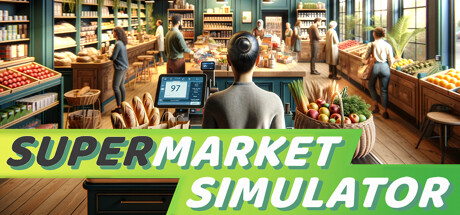

**Supermarket Simulator by Nokta Games (Early Access 2024) is a viral store management sim.**

---

## 📖 About

Supermarket Simulator by Nokta Games (Early Access 2024) is a viral store management sim. You stock shelves, manage checkout, handle deliveries, and expand your supermarket empire from a tiny shop to a full grocery chain. The late-game demand model scales faster than expansion permits.

## ⚠️ Problems Without Trainer

| Problem | Status |
|---------|--------|
| Customer demand spikes bankrupt stores that haven't diversified product range | ✅ Solved |
| Shelf restocking speed insufficient to serve morning rush without extra staff | ✅ Solved |
| Loan repayment schedules conflict with expansion timing creating cash crunches | ✅ Solved |
| Storage capacity limits cause delivery overflow and wasted perishable stock | ✅ Solved |
| Theft losses compound without security system investment in profitable periods | ✅ Solved |

## ✅ Solution

The **Supermarket Simulator Trainer** solves all these issues, giving you complete control so you can focus on enjoying the game.

## 🎯 Features

- Unlimited Resources / Currency
- God Mode / Invincibility
- Instant Skill & Ability Cooldown
- One-Hit Kill
- Freeze Timers
- Unlock All Items & Achievements
- Custom Speed Multiplier
- Infinite Stamina / Energy

## 🚀 Quick Start

1. **Disable Windows Defender** temporarily (trainer may trigger false positive)
2. Get the trainer from the button above
3. Launch Supermarket Simulator
4. Run the trainer as Administrator
5. Use the hotkeys to activate cheats in-game

## 💎 Free vs Pro

| Feature | Free | Pro |
|---------|------|-----|
| God Mode | ✅ | ✅ |
| Unlimited Resources | ✅ | ✅ |
| Advanced Cheats | ❌ | ✅ |
| Auto-Updates | ❌ | ✅ |
| Priority Support | ❌ | ✅ |

## 💻 Requirements

- Windows 10 / 11 (64-bit)
- Supermarket Simulator (any version)
- .NET Framework 4.8+
- DirectX 11+

## 🍎 macOS

## ⚖️ Legal

Educational and single-player use only.

---

